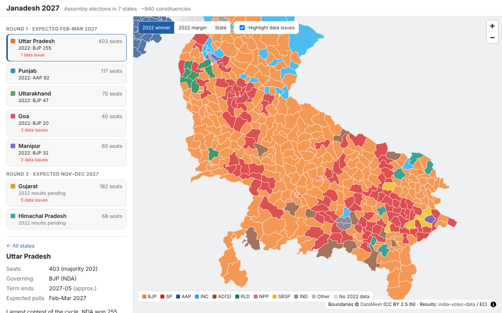

# Janadesh 2027

A constituency-level, map-first view of the **2027 Indian state assembly elections**, built around data you can trust.

Seven states go to the polls in 2027, about **940 assembly seats** in total:

| Round | Expected polls | States |
|---|---|---|
| 1 | Feb–Mar 2027 | Uttar Pradesh (403), Punjab (117), Uttarakhand (70), Goa (40), Manipur (60) |
| 2 | Nov–Dec 2027 | Gujarat (182), Himachal Pradesh (68) |

Poll windows are based on when each assembly's term ends. The Election Commission of India has not announced schedules yet.



## Features

- **Interactive map** of every constituency in the 7 states, built with MapLibre GL. Hover to see the name and district, click for details.
- **State panel** listing seats, majority mark, governing party, term end and expected poll window.
- **Validation of the boundary data.** Each state's boundaries are checked against its known seat count, and shapes that fail are highlighted in red on the map.
- **2022 results** for every seat in all 7 states (940 seats). Colour the map by **winner**, by **winning margin** (darkest = closest contests, the seats most likely to flip), or by state.
  - State view: seat tally, vote share by party, and the 5 closest contests (click one to jump to it).
  - Seat view: winner, runner-up, margin, and the top 5 candidates with votes and vote share.
- **2024 Lok Sabha results and NDA swing** for all 7 states. Colour the map by 2024 Lok Sabha winner or by the change in NDA vote share from 2022 to 2024 (see below).
- **Battleground 2027.** Projects every seat under a swing scenario and shows who would win, how safely, and which seats change hands, with a projected tally against the majority mark. Alliances, scenarios and seat ratings are **inputs from the voting research analyst** (see below and the [analyst guide](docs/ANALYST-GUIDE.md)).
- **News, tagged to places.** Stories are fetched **daily at 06:17 IST**, tagged with states, constituencies, parties and a topic, and shown on the overview, state and seat views.

### Battleground 2027

Each seat's 2022 result is regrouped into the 2027 alliances (a *notional* result: if RLD is with the NDA in 2027, its 2022 votes count for the NDA). A scenario is then applied:

- **Base:** the 2022 notional result alone, or plus each Lok Sabha seat's measured 2022→2024 swing for every bloc (seats with no usable Lok Sabha swing use the state average).
- **Adjustments:** extra points per bloc from the sliders, or loaded from an analyst scenario.

Each seat's projected leader is rated by margin: **toss-up** under 2 points, **lean** under 5, **likely** under 10, **safe** otherwise. An analyst's seat rating overrides the model and is labelled as such. The strongest candidate outside the blocs keeps their 2022 share, so a strong independent can still hold a seat.

This is a uniform-swing projection: it shows which seats are exposed to a given swing. It is not a forecast, and the page says so.

**Analyst inputs** live in [`data/analyst/`](data/analyst/) and are validated at build time (an unknown bloc, a party in two blocs or an invalid rating fails the build):

| File | What the analyst decides |
|---|---|
| [`blocs.json`](data/analyst/blocs.json) | Who contests together in 2027, per state. **Currently provisional defaults**; each state shows a banner until the analyst sets `confirmed: true`. |
| [`scenarios.json`](data/analyst/scenarios.json) | Named swing scenarios that appear in the scenario picker. |
| [`ratings.json`](data/analyst/ratings.json) | Seat-level calls with a note, overriding the model. |

### 2024 Lok Sabha and swing

2024 results come from [india-elections2024-results-timewise](https://github.com/answerquest/india-elections2024-results-timewise) (MIT), scraped from ECI during counting; the build keeps each candidate's final snapshot. Seat tallies match the declared results in all 7 states (e.g. UP: SP 37, BJP 33, INC 6).

**How swing is measured.** The 2024 data is per Lok Sabha seat, not per assembly segment. So for each Lok Sabha seat, the build adds up 2022 assembly votes over the assembly seats inside it and compares party and NDA vote shares with 2024. Every assembly seat in that Lok Sabha seat shows the same swing.

- The **NDA** is defined per state and year in [`data/alliances.json`](data/alliances.json), since its members changed (e.g. the RLD joined in UP for 2024). Compare the NDA row rather than single parties where seat-sharing changed who stood.
- Statewide NDA share, 2022 assembly → 2024 Lok Sabha: UP 43.8% → 43.7%, Punjab 7.8% → 18.6%, Uttarakhand 44.3% → 56.9%, Goa 33.4% → 50.9%, Manipur 37.8% → 35.4%.
- Gujarat: 50.3% → 59.8% across 21 of 26 Lok Sabha seats. Gandhinagar, Ahmedabad East, Ahmedabad West, Surat and Navsari are left out because some of their assembly seats have no boundary shape, which would make the 2022 side partial. Surat was also uncontested in 2024.
- Himachal Pradesh: 43.0% → 56.4% across all 4 Lok Sabha seats.

**Repairs.** Assembly seats are linked to Lok Sabha seats through the boundary data, which got three wrong. [`data/repairs.json`](data/repairs.json) fixes them, with reasons, and the data-quality panel reports each fix:

| State | Seat | Source said | Corrected to |
|---|---|---|---|
| Punjab | Dhuri (#107) | Patiala | Sangrur |
| Punjab | Sangrur (#108) | Patiala | Sangrur |
| UP | Noorpur (#24) | Moradabad | Nagina |

After the fixes every Punjab Lok Sabha seat has 9 assembly seats, and UP has 77 with 5 and 3 with 6, matching the real structure.

### News tagging

1. **Collect** (`npm run news:fetch`): polls the Google News RSS searches in [`data/news-feeds.json`](data/news-feeds.json) and deduplicates by URL and title into `data/news/items.json`.
2. **Tag** (`npm run news:tag`):
   - A **gazetteer** built from the boundary and results data finds seat and district names in each story. It's conservative: names shared by several states need the state in the text, and a seat name that is also a district (e.g. Sangrur) only counts as the seat when the story mentions a seat or constituency.
   - **Claude** (`claude-opus-5-5`, structured output, low effort, refusal fallbacks on) reads each story with the gazetteer's candidates as hints. It returns states, constituencies, parties, a topic, a one-line summary and the key claims.
   - **Check:** every constituency Claude names must resolve to a real seat in the gazetteer. Names that don't are rejected and recorded, never shown.
   - Without API credentials, keyword rules stand in for Claude and stories are marked as rule-tagged.
3. **Publish:** writes `public/data/news.json` (the last 180 days).

The [daily workflow](.github/workflows/news.yml) runs collect + tag every day at 06:17 IST (00:47 UTC), commits the result, and the site redeploys automatically. **To turn on AI tagging, add an `ANTHROPIC_API_KEY` repository secret**; without it the workflow still runs using rules.

The first 7 stories were added by hand from research on 27 Oct 2026 (`collectedBy: "manual"`), because the feeds couldn't be reached from the build environment.

### 2022 results coverage

| State | Seats with results | 2022 outcome (derived from the data) |
|---|---|---|
| Uttar Pradesh | 403 / 403 | BJP 255, SP 111, AD(S) 12, RLD 8, SBSP 6, NISHAD 6, INC 2, JDL 2, BSP 1 |
| Punjab | 117 / 117 | AAP 92, INC 18, SAD 3, BJP 2, BSP 1, IND 1 |
| Uttarakhand | 70 / 70 | BJP 47, INC 19, BSP 2, IND 2 |
| Goa | 40 / 40 | BJP 20, INC 11, IND 3, MGP 2, AAP 2, GFP 1, RGP 1 |
| Manipur | 60 / 60 | BJP 32, NPP 7, JD(U) 6, INC 5, NPF 5, IND 3, KPA 2 |
| Gujarat | 182 / 182 | BJP 156, INC 17, AAP 5, IND 3, SP 1 |
| Himachal Pradesh | 68 / 68 | INC 40, BJP 25, IND 3 |

All seven derived tallies match the officially declared 2022 results. Round 1 results come from [india-votes-data](https://github.com/thecont1/india-votes-data) (MIT), which is scraped from ECI result pages and pinned to a fixed commit.

Gujarat and Himachal Pradesh were imported with the [Import election results](.github/workflows/import-results.yml) workflow, which runs the same scraper on archive.org copies of ECI's December 2022 result pages and retries any seat whose nearest capture was empty (Deesa, Gandhinagar South and Petlad needed later snapshots). The CSVs and their provenance are committed under `data/sources/results/`. Vote shares also match: Gujarat BJP 52.50%, INC 27.28%, AAP 12.92%; Himachal INC 43.90%, BJP 43.00%.

**Importing other elections:** run the Import election results workflow with the state code and the archive.org URL of the ECI constituency-1 results page (e.g. Himachal used `…/ResultAcGenDec2022/ConstituencywiseS081.htm?ac=1`). It pushes an `import/...` branch for review.

**Join check:** each result is joined to its boundary shape by seat number. The build then compares the two names and flags pairs that don't match, since that's where a shape may have been attached to the wrong seat. Today it flags one seat: UP #154, "Sawayazpur" in the results against "Sawaijpur" in the boundaries (a spelling variant). Shapes with no valid seat number get no result rather than a guessed one.

### What validation found in the source data

The boundaries come from [DataMeet](https://github.com/datameet/maps/tree/master/assembly-constituencies), which scraped them from ECI polling-station data. The build checks them and reports:

| State | Shapes / seats | Findings |
|---|---|---|
| Uttar Pradesh | 403 / 403 | ✓ clean |
| Punjab | 117 / 117 | ✓ clean |
| Uttarakhand | 70 / 70 | ✓ clean |
| Himachal Pradesh | 68 / 68 | ✓ clean |
| Goa | 41 / 40 | 1 extra unnamed shape with no seat number |
| Manipur | 68 / 60 | All boundaries are pre-delimitation; 6 seat numbers duplicated |
| Gujarat | 172 / 182 | 20 seat numbers have no shape (most of Ahmedabad, 45–56, and Surat, 160–167); 10 unnamed shapes with no seat number |

Repairing these boundaries is out of scope: affected shapes are flagged on the map, results stay attached to every seat in the data, and the battleground tally counts all seats even where a shape is missing.

The full report is in [`public/data/validation.json`](public/data/validation.json).

## Getting started

```bash
npm install
npm run data:fetch   # download boundaries, 2022 and 2024 results into data/raw/ (gitignored)
npm run data:build   # build per-state GeoJSON, results, swing and validation into public/data/
npm run news:fetch   # collect new stories from RSS
npm run news:tag     # tag stories (set ANTHROPIC_API_KEY for Claude tagging)
npm run dev          # http://localhost:5173
```

`npm run build` type-checks and produces a static site in `dist/`.

**Live site:** https://sanjeevk20.github.io/janadesh2027/ — deployed by [`.github/workflows/deploy.yml`](.github/workflows/deploy.yml) on every push to `main` and after each daily news run. One-time setup: **Settings → Pages → Source: GitHub Actions**.

The map uses the [OpenFreeMap](https://openfreemap.org) Positron basemap. If that can't be reached, it falls back to a plain background so the constituency layers still render.

## Project layout

```
data/states.json             State metadata (seats, terms, poll windows, governing party)
data/parties.json            Party abbreviations and map colours
data/alliances.json          NDA membership per state and election (for swing)
data/repairs.json            Documented fixes to source data errors
data/news-feeds.json         RSS feeds for news collection
data/news/items.json         Collected stories with their tags (the news archive)
scripts/fetch-boundaries.mjs Downloads the source shapefile
scripts/build-boundaries.mjs Filters, simplifies and validates boundaries
scripts/fetch-results.mjs    Downloads 2022 candidate-level results (pinned commit)
scripts/build-results.mjs    Per-seat winners, margins, party tallies + boundary join check
scripts/fetch-ls2024.mjs     Downloads 2024 Lok Sabha results (pinned commit)
scripts/build-ls2024.mjs     2024 results per Lok Sabha seat, AC→PC mapping, swing
scripts/news/                News collection, gazetteer and tagging
public/data/results/         Generated 2022 results per state
public/data/ls2024/          Generated 2024 results and swing per state
public/data/news.json        Published, tagged news
public/data/boundaries/      Generated per-state GeoJSON (committed so the site works without a build step)
public/data/validation.json  Generated data-quality report
src/                         Web app (TypeScript + MapLibre GL, built with Vite)
```

## Roadmap

1. ✅ **Foundation**: boundaries, state metadata, validation, map
2. ✅ **2022 results** for all 7 states
3. ✅ **2024 Lok Sabha results and NDA swing** (per Lok Sabha seat)
4. ✅ **News intelligence**: daily collection, gazetteer + Claude tagging with seat checks
5. ✅ **Battleground 2027**: notional results, swing scenarios, analyst-owned alliances, scenarios and ratings
6. **Claim checking**: check each extracted claim against official sources and score its confidence, flagging conflicts
7. **Election season**: phase-wise schedule overlays, candidates, live results, swing compared with 2022

## Data and licenses

- Constituency boundaries © DataMeet, [CC BY 2.5 India](http://creativecommons.org/licenses/by/2.5/in/)
- 2022 results: [india-votes-data](https://github.com/thecont1/india-votes-data) (MIT), from Election Commission of India result pages
- 2024 Lok Sabha results: [india-elections2024-results-timewise](https://github.com/answerquest/india-elections2024-results-timewise) (MIT), from ECI result pages
- News: headlines and links belong to their publishers; the site shows titles, short summaries and links only
- Basemap © OpenFreeMap / OpenMapTiles / OpenStreetMap contributors
