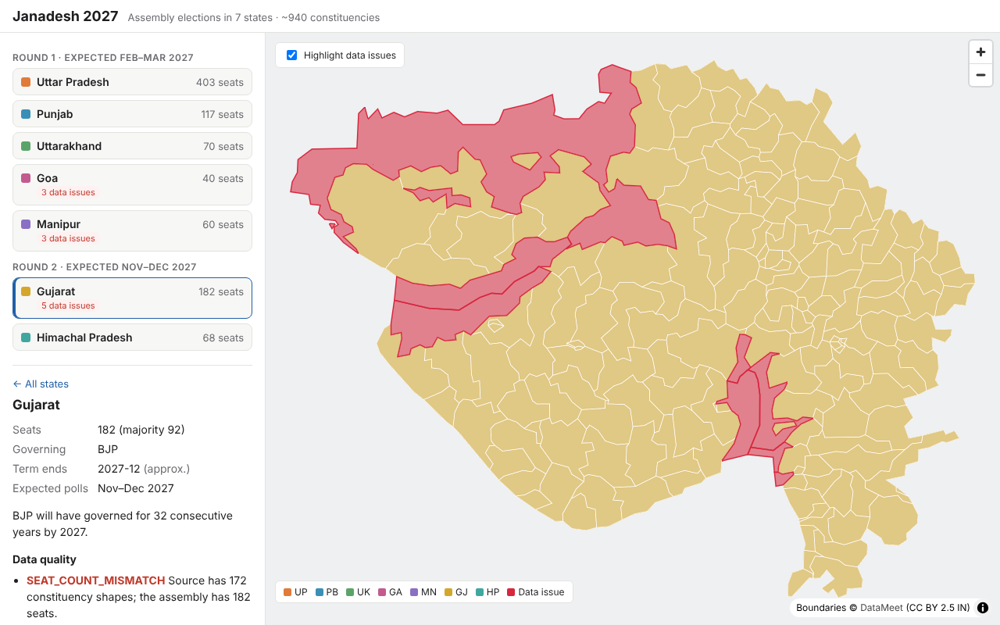

# Janadesh 2027

A constituency-level, map-first view of the **2027 Indian state assembly elections**, built around data you can trust.

Seven states go to the polls in 2027, about **940 assembly seats** in total:

| Round | Expected polls | States |
|---|---|---|
| 1 | Feb–Mar 2027 | Uttar Pradesh (403), Punjab (117), Uttarakhand (70), Goa (40), Manipur (60) |
| 2 | Nov–Dec 2027 | Gujarat (182), Himachal Pradesh (68) |

Poll windows are based on when each assembly's term ends. The Election Commission of India has not announced schedules yet.



## What's in Phase 1

- **Interactive map** of every constituency in the 7 states, built with MapLibre GL. Hover to see the name and district, click for details.
- **State panel** listing seats, majority mark, governing party, term end and expected poll window.
- **Validation of the boundary data.** Each state's boundaries are checked against its known seat count, and shapes that fail are highlighted in red on the map.

### What validation found in the source data

The boundaries come from [DataMeet](https://github.com/datameet/maps/tree/master/assembly-constituencies), which scraped them from ECI polling-station data. The build checks them and reports:

| State | Shapes / seats | Findings |
|---|---|---|
| Uttar Pradesh | 403 / 403 | ✓ clean |
| Punjab | 117 / 117 | ✓ clean |
| Uttarakhand | 70 / 70 | ✓ clean |
| Himachal Pradesh | 68 / 68 | ✓ clean |
| Goa | 41 / 40 | 1 extra unnamed shape with no seat number |
| Manipur | 68 / 60 | All boundaries are pre-delimitation; 6 seat numbers duplicated |
| Gujarat | 172 / 182 | 20 seat numbers have no shape (most of Ahmedabad, 45–56, and Surat, 160–167); 10 unnamed shapes with no seat number |

These need repairing against official ECI delimitation data before results can be attached to them. That repair is the next step for this data.

The full report is in [`public/data/validation.json`](public/data/validation.json).

## Getting started

```bash
npm install
npm run data:fetch   # download the DataMeet shapefile into data/raw/ (gitignored)
npm run data:build   # build per-state GeoJSON + validation report into public/data/
npm run dev          # http://localhost:5173
```

`npm run build` type-checks and produces a static site in `dist/`. It can be hosted on GitHub Pages, Vercel or Cloudflare Pages.

The map uses the [OpenFreeMap](https://openfreemap.org) Positron basemap. If that can't be reached, it falls back to a plain background so the constituency layers still render.

## Project layout

```
data/states.json             State metadata (seats, terms, poll windows, governing party)
scripts/fetch-boundaries.mjs Downloads the source shapefile
scripts/build-boundaries.mjs Filters, simplifies and validates boundaries
public/data/boundaries/      Generated per-state GeoJSON (committed so the site works without a build step)
public/data/validation.json  Generated data-quality report
src/                         Web app (TypeScript + MapLibre GL, built with Vite)
```

## Roadmap

1. **Foundation** (this phase): boundaries, state metadata, validation, map
2. **2022 results**: winner, party, margin and vote share for each seat
3. **News intelligence**: weekly news collection, with each story tagged by an LLM to the state, constituency, parties and type of claim
4. **Claim checking**: each claim checked against official sources and given a confidence score, with conflicts flagged
5. **Election season**: phase-wise schedule overlays, candidates, live results, swing compared with 2022

## Data and licenses

- Constituency boundaries © DataMeet, [CC BY 2.5 India](http://creativecommons.org/licenses/by/2.5/in/)
- Basemap © OpenFreeMap / OpenMapTiles / OpenStreetMap contributors
